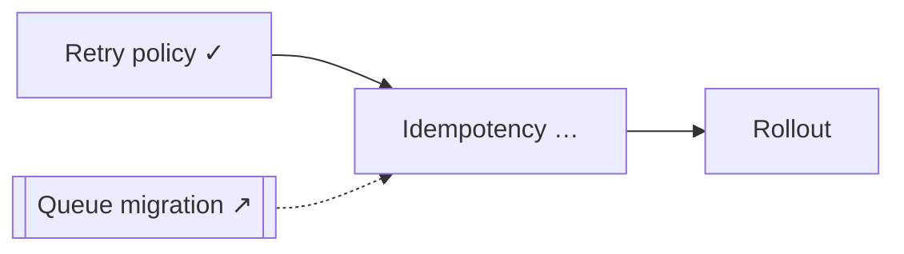

# Presentation templates

Pick the lightest form that carries the state. Always pair a picture with one sentence saying what changed.

## Terminal: ASCII thread map

Show it after Frame and on resume, and at checkpoints where the live pane doesn't draw. Use 10-cell bars: `open` = 0, `partial` = 5, `enough` = 10. Parked and spun-off threads show no bar.

```text
Billing retry redesign · plan · session 2
Goal: Decide how failed charges are retried after the queue migration
Enough when: every phase has a testable exit criterion

  T1 Retry policy      ██████████  enough
  T2 Idempotency       █████░░░░░  partial   key scope unclear
  T5 Rollout           ░░░░░░░░░░  open
  T3 Queue migration   ↗ spun off  ../queue-migration
  T4 Alerting          ‖ parked    after phase 1

Progress 1/3 in scope · 7 decisions · 3 open · 2 to verify
Now: Q2 (T2) Is the idempotency key per charge or per invoice?
```

## Docs: Mermaid

Use these inside `ledger.md` or the outcome document.

Thread dependencies (what unblocks what):



Use a `sequenceDiagram` for a flow being understood or debugged, a `stateDiagram-v2` for lifecycle questions, and a `timeline` or `gantt` for phased plans.

## Interactive

When the map has more than about 10 threads, the dependencies cross, or the user must compare options on several axes, offer an HTML artifact (a clickable dependency graph, an option matrix, a timeline). Offer it; don't build it unasked. Build it from `interview.json` plus the ledger so it can be regenerated later.

## Live pane (mod)

In the terminal and the desktop app, the plugin's mod draws a one-line band above the prompt (progress, the question at the head of `queue`, an Expand/Collapse button) and an `/interview-map` pane (threads, NOW, UP NEXT, SETTLED), refreshed whenever Claude writes `interview.json` or the ledger with `Write` or `Edit`. The user hides or shows both with `/interview-progress`, or the pane's Hide button; respect that and don't re-open the pane after they hide it. `/interview-cleanup` opens a keyboard- and click-driven list of finished, idle or orphaned interviews. Its Open, Archive and Delete buttons put a request in the user's prompt, which you then carry out following `storage.md`.

The mod doesn't draw in VS Code, cloud sessions or `claude -p`, so the ASCII map at checkpoints remains the baseline.
