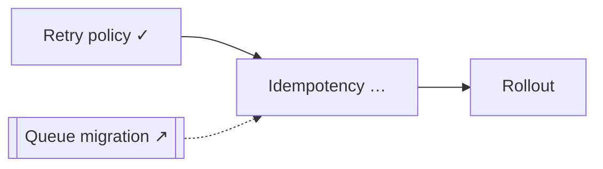

# Presentation templates

Pick the lightest form that carries the state. Always pair a picture with one sentence saying what changed.

## Terminal: ASCII thread map

Show it after Frame, at checkpoints and on resume. Use 10-cell bars: `open` = 0, `partial` = 5, `enough` = 10. Parked and spun-off threads show no bar.

```text
Billing retry redesign · plan · session 2, round 5
Goal: Decide how failed charges are retried after the queue migration
Enough when: every phase has a testable exit criterion

  T1 Retry policy      ██████████  enough
  T2 Idempotency       █████░░░░░  partial   key scope unclear
  T5 Rollout           ░░░░░░░░░░  open
  T3 Queue migration   ↗ spun off  ../queue-migration
  T4 Alerting          ‖ parked    after phase 1

Progress 1/3 in scope · 7 decisions · 3 open · 2 to verify
Next: Round 6, idempotency key scope (T2), 3 questions
```

## Question set framing

```text
Round 6 · T2 Idempotency
Why now: phase 1's API shape depends on the key's scope.
After this: I can draft the "Charge API" section of the plan.

1. Is a retry the same charge or a new one?  Recommend: same charge, so one key per charge.
2. ...
```

## Docs: Mermaid

Use these inside `ledger.md` or the outcome document.

Thread dependencies (what unblocks what):



Use a `sequenceDiagram` for a flow being understood or debugged, a `stateDiagram-v2` for lifecycle questions, and a `timeline` or `gantt` for phased plans.

## Interactive

When the map has more than about 10 threads, the dependencies cross, or the user must compare options on several axes, offer an HTML artifact (a clickable dependency graph, an option matrix, a timeline). Offer it; don't build it unasked. Build it from `interview.json` plus the ledger so it can be regenerated later.

## Live pane (mod)

If the `dynamic-interview` mod is loaded, `/interview-map` opens a pane drawn from `interview.json`, and a one-line band above the prompt shows the slug, round, progress and next step. It refreshes whenever Claude reads or writes an `interview.json`, so keep that file current. The ASCII map is still worth printing at checkpoints, because the pane may be closed or unsupported.
